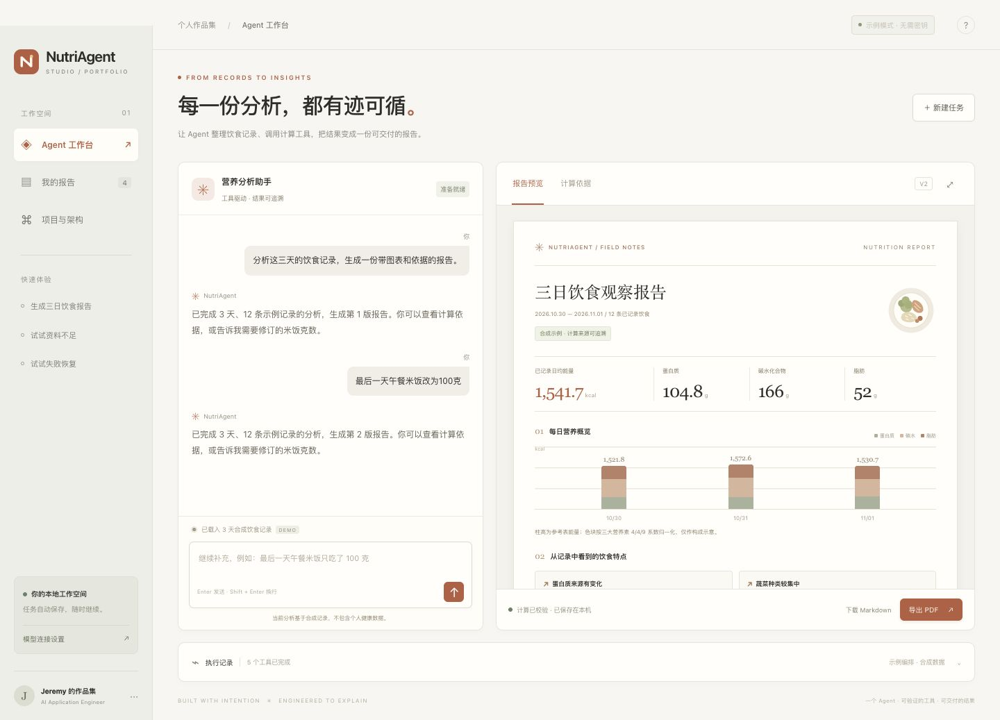

# NutriAgent Studio

一个可自行维护的 AI 应用工程作品集：让 Agent 读取饮食记录、调用营养计算工具、补充缺失信息，生成带依据的报告。

**当前版本是可运行的本地单人 MVP。默认示例模式无需密钥；配置兼容模型后，真实 Agent 会选择工具并执行。两种模式都使用本项目合成数据。**



## 启动

需要 Node.js 22 或更高版本。项目只使用 Node 标准库和浏览器原生 API，无第三方运行时依赖，无需 `npm install`。

```sh
cd nutriagent-studio
npm start
```

打开 <http://127.0.0.1:4371>。开发时可用 `npm run dev`，后端修改后自动重启；前端文件修改后刷新浏览器。

如果文件监听报 `EMFILE`，使用不带监听的 `npm start`。端口被占用时，在 `.env` 设置其他 `PORT`。

## 已实现

- 中文响应式 Agent 工作台、报告库、架构介绍与模型设置说明。
- 三种预置体验：生成报告、份量不足时暂停追问、失败后复用结果恢复。
- 确定性营养换算、逐原料依据、汇总校验与报告版本。
- SSE 执行事件及自动重连；任务逐步保存到 `.local/runs/`。
- 浏览器刷新恢复最近任务；服务重启后中断任务可重试。
- Markdown 下载；浏览器打印对话框中“另存为 PDF”，包含报告及计算依据。
- 兼容 Chat Completions 的真实工具调用循环：最多 6 轮、12 次工具调用，支持超时、失败与 Token 用量事件。
- 单元与 HTTP 集成测试、GitHub Actions CI。

## 真实模型模式

```sh
cp .env.example .env
```

在 `.env` 填写以下字段，然后重新启动服务：

```dotenv
MODEL_BASE_URL=https://your-compatible-provider.example/v1
MODEL_NAME=your-tool-capable-model
MODEL_API_KEY=your-secret
```

服务必须支持 `/chat/completions`、`tools` 及 `tool_calls`。密钥只在服务端读取，不写入报告、执行记录或浏览器。没有完整配置时显示“示例模式”；有配置时显示“真实模型”。失败恢复演示场景固定使用示例编排。

真实模式发送当前输入、有限会话历史及合成饮食工具结果给所配置的服务。不要在演示中输入真实健康资料。本项目未随附密钥，交付验证使用模型协议替身，未实测付费模型。

## 三分钟演示

1. 点击“生成三日饮食报告”，展开底部“执行记录”，查看四个实际工具结果。
2. 点击“计算依据”，查看熟米饭 `116 × 180 ÷ 100 = 208.8 kcal`。
3. 输入“最后一天午餐米饭改为 100 克”，查看 V2 报告、变化的能量和保留的 V1。
4. 新建任务，选择“试试资料不足”，补充“米饭实际吃了 100 克”后继续。
5. 新建任务，选择“试试失败恢复”，点击重试，确认只执行报告生成工具。
6. 下载 Markdown；点“导出 PDF”，在打印窗口选择另存为 PDF。

## 如何自己更新

| 内容 | 文件 |
|---|---|
| 姓名、个人定位、项目介绍 | `public/index.html` |
| 颜色、布局、响应式、打印样式 | `public/styles.css` |
| 对话、报告预览、图表、报告库 | `public/app.js` |
| 示例输入、原料参考表、计算、报告模板 | `src/domain.js` |
| Agent 工具、提示词和执行循环 | `src/agent.js` |
| API、SSE、任务保存、模型配置 | `src/server.js` |

日常修改后：

```sh
npm run check
npm test
git add .
git commit -m "更新作品集内容"
git push
```

上传到新 GitHub 账号的步骤见 [仓库维护](docs/MAINTENANCE.md)。实现细节见 [架构](docs/ARCHITECTURE.md)，后续范围见 [路线图](docs/ROADMAP.md)。

## 当前边界

- 输入记录是 2026-10-30 至 2026-11-01 的固定合成样例，不读取原业务后台。
- 份量修订仅支持最近一日午餐米饭，按明确克数或“一半”处理；任意餐食录入、照片识别、向量检索和 RAG 尚未接入。
- 模型负责工具编排及对话，报告观察正文目前是透明的确定性模板，不宣称生成个性化营养建议。
- 参考表为自建演示值，验证重点是计算、工具选择和恢复机制，不代表真实营养识别准确率。
- PDF 通过浏览器打印保存，不包含服务端 Chromium 渲染。
- 本机单人模式仅监听 localhost；未提供公开网站部署、用户登录与多租户隔离。分享源码不等于可以直接公开服务。
- 任务文件位于 `.local/`，报告库索引位于浏览器 localStorage。不同浏览器不共享列表，文件本身仍保存在服务器目录。

## 来源

围绕营养分析与报告交付问题独立编写；没有拷贝原公司业务代码、真实资料、密钥或内部报告。不能把原团队完整能力写成个人独立开发。本项目尚未选择开源许可证；上传公开仓库前可自行确定许可。
